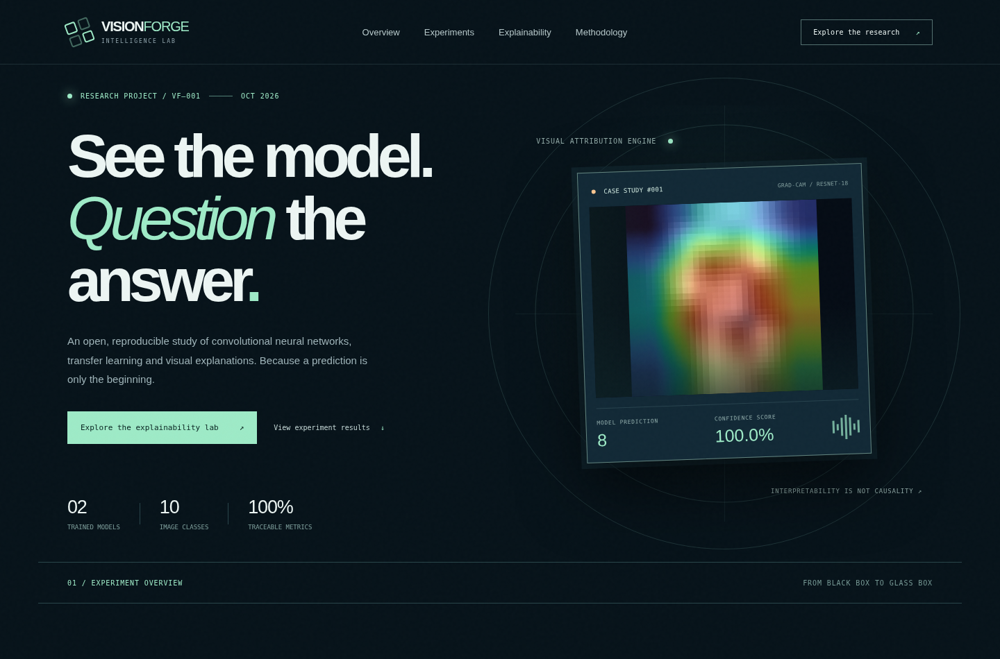
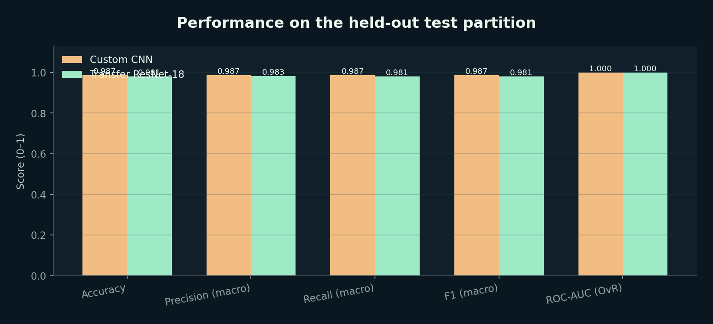
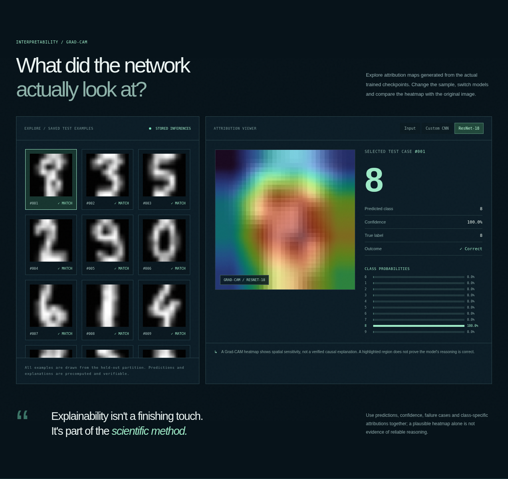
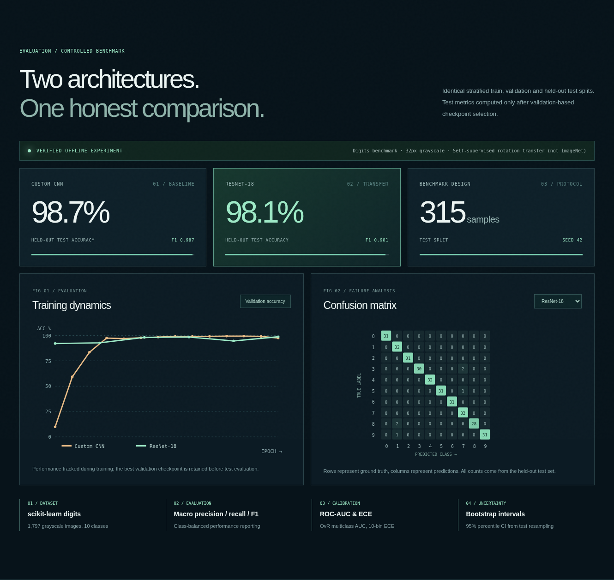
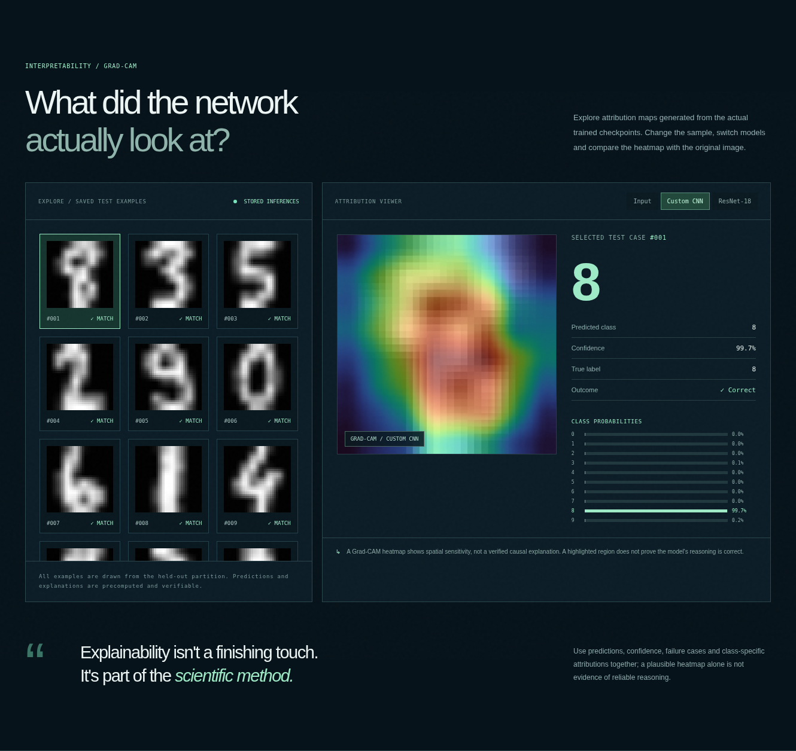

<div align="center">

# ◈ VISIONFORGE

### See the model. *Question* the answer.

**A reproducible explainable computer-vision research lab**  
PyTorch · Custom CNN · ResNet-18 · Self-supervised transfer · Grad-CAM · ROC-AUC · Evaluation & calibration

**Executed benchmark** · **2 trained checkpoints included** · **12 real Grad-CAM case studies** · **6 browser screenshots**

</div>



> **Project status — VERIFIED EXPERIMENT.** The included metrics, weights, heatmaps and screenshots are generated from a real CPU-trained benchmark. This is an independent research portfolio project designed around areas in the BTU Cottbus-Senftenberg Artificial Intelligence M.Sc. curriculum; it is **not** an official BTU project. The offline pilot is on a small handwriting benchmark, *not ImageNet or CIFAR-10*. A separate, **unexecuted** ImageNet→CIFAR-10 extension is provided.

## Research question

When working with limited labeled image data, how does a transparent custom CNN compare with a larger residual network that has been pretrained to understand rotations? Can we measure the difference with proper held-out evaluation, and visually inspect *where* their class predictions arise?

VISIONFORGE is deliberately more than an upload-a-picture UI: it includes controlled experimental design, genuine source pretraining, two downstream classifiers, model selection, performance analysis, calibration and explanation maps.

## Verified result · VF-001

| Held-out metric | Custom CNN (scratch) | ResNet-18 (rotation transfer) |
|:--|--:|--:|
| **Accuracy** | **98.73%** | **98.10%** |
| Macro precision | 98.75% | 98.29% |
| Macro recall | 98.73% | 98.08% |
| Macro F1 | **98.72%** | 98.12% |
| Multiclass ROC-AUC (macro OvR) | 0.999887 | **0.999932** |
| 10-bin calibration error (ECE ↓) | 0.04468 | **0.00930** |
| Bootstrap accuracy CI (95%) | 97.46–99.68% | 96.51–99.37% |
| Correct / test samples | 311 / 315 | 309 / 315 |

**Interpretation:** The small CNN is slightly more accurate on this small, single-split benchmark, while rotation-pretrained ResNet-18 has marginally higher ROC-AUC and lower calibration error. Two fewer correct predictions do not establish a meaningful generalization gap; **this is one split with one seed, different training budgets and a very small source image size**.



### Explainability is built in

Grad-CAM uses the final convolutional feature maps and gradients of the chosen class score. The maps below were **computed from the saved model checkpoints on held-out test images**—they are not decorative, generative, or inferred from the class labels.



> A Grad-CAM region is *spatial attribution*, not a proof of causal reasoning. We deliberately present correct/incorrect labels and confidence beside each explanation.

## What is included?

| Layer | Included functionality |
|---|---|
| **Models** | Custom PyTorch CNN with 3 learned convolution stages; trained 1-channel ResNet-18 with modified stem |
| **Source pretraining** | Four-way (0°, 90°, 180°, 270°) rotation prediction on training images; saved source task checkpoint |
| **Transfer learning** | Complete residual network fine-tuning on digit recognition; train + validation checkpoint selection |
| **Evaluation** | Macro precision/recall/F1, confusion matrices, OvR ROC-AUC, per-class scores, ECE, percentile bootstrap confidence intervals |
| **Explainability** | Real Grad-CAM model hooks, class-sensitive heatmaps, 12 stored test example comparisons |
| **Web report** | Responsive, interactive, GitHub Pages–ready HTML/CSS/JS research dashboard with model comparison and sample explorer |
| **Live demo** | Streamlit-based image upload/inference app using supplied checkpoints and dynamically computed Grad-CAM |
| **Engineering** | Reproducible commands, public benchmark loader, documented model cards, automated pytest tests and GitHub Actions CI |
| **Expansion** | Separate optional ImageNet-pretrained ResNet-18 vs scratch CNN experiment on CIFAR-10 (code only; not run here) |

### Research report (included PDF)

A six-page research report with the official BTU curriculum mapping, real evaluation results, confusion matrices, training curves and Grad-CAM gallery is included at **[docs/VISIONFORGE_Research_Report.pdf](docs/VISIONFORGE_Research_Report.pdf)**.

### More actual UI screenshots

| Experimental results | Selecting explanations |
|:--:|:--:|
|  |  |

## Experiment protocol

```text
scikit-learn digits (1,797 real 8×8 grayscale images)
      │   Normalize / 16; bilinear upscale to 32×32
      ├── 1,168 TRAIN ────────────────────────┬──────────────┐
      │                                       │              │
      │                           Supervised labels     Self-supervised
      │                                       │          rotation source task
      │                                       ▼              │
      │                                Custom CNN       ResNet-18
      │                                  (scratch)     4-class pretext
      │                                       │              │
      │                                       │              ▼
      │                                       │          replace head
      │                                       │          10-class fine-tune
      │                                       │              │
      ├── 314 VALIDATION ─────────────────────┴──────────────┤
      │                           Select best checkpoint   │
      └── 315 TEST ──────────────── evaluate both checkpoints
                                    │
                    accuracy / macro PRF1 / OvR ROC-AUC
                      confusion / ECE / confidence CI
                              │
                       genuine Grad-CAM
                              │
                      browser research report
```

The rotated images are **augmented views of the *training partition***, not a distinct external corpus. This is genuine *within-domain task transfer*, but **not ImageNet transfer**. The optional separate script provides the standard ImageNet→CIFAR-10 setting.

## Repository map

```text
VISIONFORGE_Explainable_AI/
├── README.md
├── app.py                          # Actual model inference + uploads (Streamlit)
├── requirements.txt
├── visionforge/
│   ├── data.py                     # Stratified benchmark loading
│   ├── models.py                   # Two PyTorch architectures
│   ├── engine.py                   # Train, validate and predict
│   ├── metrics.py                  # PRF1, confusion, multiclass AUC, ECE, CI
│   └── explain.py                  # Gradient-weighted CAM from hooks
├── scripts/
│   ├── run_experiment.py           # Reproduce verified offline benchmark
│   ├── train_cifar10.py            # Optional ImageNet extension (NOT run)
│   ├── export_assets.py            # Real visualizations and case exports
│   └── capture_screenshots.py      # Browser capture from actual source
├── experiments/offline_digits/
│   ├── EXPERIMENT.md               # Study methods and verified results
│   ├── results.json                # Experiment ledger / all numeric metrics
│   └── artifacts/
│       ├── custom_cnn.pt
│       ├── rotation_source_weights.pt
│       ├── rotation_resnet18.pt
│       └── *_predictions.npz       # Real probabilities + test split indices
├── web/
│   ├── index.html                  # Publishable GitHub Pages dashboard
│   ├── styles.css
│   ├── app.js
│   └── assets/                    # Metrics JSON + 12 × Grad-CAM examples
├── docs/
│   ├── assets/                    # Real experiment plots
│   ├── screenshots/              # 6 ACTUAL Chromium captures
│   ├── BTU_ALIGNMENT.md
│   ├── MODEL_CARDS.md
│   ├── DATASET_CARD.md
│   └── REPRODUCIBILITY.md
├── tests/                          # CPU smoke tests and correctness checks
└── .github/workflows/
    ├── tests.yml                   # Automated Python tests
    └── pages.yml                   # Automatic GitHub Pages deployment
```

## View it without running anything locally

**Option A — GitHub portfolio (zero local setup):** Unzip the supplied package. Create a GitHub repo, upload the **contents** of the unzipped folder (not the ZIP file as one blob), then open `README.md`. GitHub renders the results and screenshots automatically.

**Option B — Public interactive web dashboard (zero local setup):** After pushing to your `main` branch, open your repo **Settings → Pages → Build and deployment → GitHub Actions**. The supplied Pages workflow publishes the `web` directory and provides a public link when deployment succeeds. The dashboard works with precomputed data, no model server needed.

**Option C — Cloud live inference (no local setup):** Deploy `app.py` to [Streamlit Community Cloud](https://share.streamlit.io/) by connecting the GitHub repository. The included checkpoints enable digit image uploads and Grad-CAM inference on the hosted server. This requires the Cloud service to install `requirements.txt` and run Python; the user does not train anything.

For step-by-step publishing instructions see **[the upload guide](docs/UPLOAD_GUIDE.md)**.

## Optional: reproduce experiments yourself

> **This is not required to submit or browse the project.**

```bash
python -m pip install -r requirements.txt pytest
pytest -q tests
python scripts/run_experiment.py --cnn-epochs 14 --pretext-epochs 2 --transfer-epochs 6
python scripts/export_assets.py
streamlit run app.py
```

To run the separate, larger **actual ImageNet-pretrained** transfer learning experiment (downloads required):

```bash
python scripts/train_cifar10.py --train-limit 12000 --cnn-epochs 10 --transfer-epochs 5
```

Results for this optional study are **not included**: its pipeline was implemented but not executed here. Do not copy the offline-digit results into a CIFAR-10 claim.

## Curriculum relevance

The project has clear methodological overlap with BTU's [Artificial Intelligence M.Sc.](https://www.b-tu.de/en/artificial-intelligence-ms), especially **14186 Image Processing and Computer Vision**, **14021 Explainable Machine Learning**, **11847 Neural Networks and Learning Theory**, and **14449 Workflows for Machine Learning and Reproducible Science Laboratory**. See [curriculum mapping and official handbook references](docs/BTU_ALIGNMENT.md). **Curriculum overlap is not an admissions guarantee.**

## Research limits & responsible interpretation

This is a *small scientific pilot*. A 32×32-resized 8×8 monochrome dataset cannot validate general natural-image recognition. The results use one 315-image test split and one seed, do not compute significance for model differences, and use an unequal pretraining budget. Models may be overconfident on out-of-distribution uploads. Class attribution heatmaps do not prove causality. The demo is not appropriate for safety-critical or production decisions. Please inspect [complete experiment notes](experiments/offline_digits/EXPERIMENT.md), [model cards](docs/MODEL_CARDS.md) and [dataset card](docs/DATASET_CARD.md).

**Research provenance:** All stated offline results were executed and inspected; no fabricated scores, fake deployment URLs, or made-up user studies are presented. Web images are screenshots of the actual local-rendered dashboard. Additional contributions and future datasets can be explored independently.

**Open source:** MIT (software source); public benchmark data attribution is documented separately.
