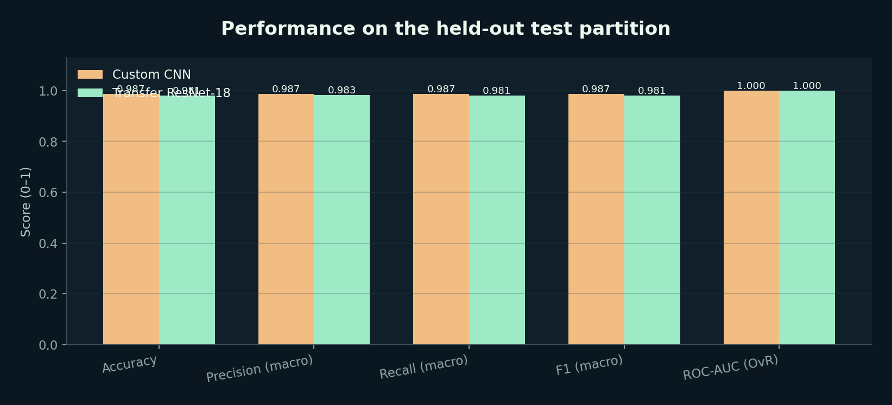
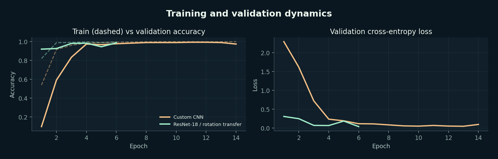
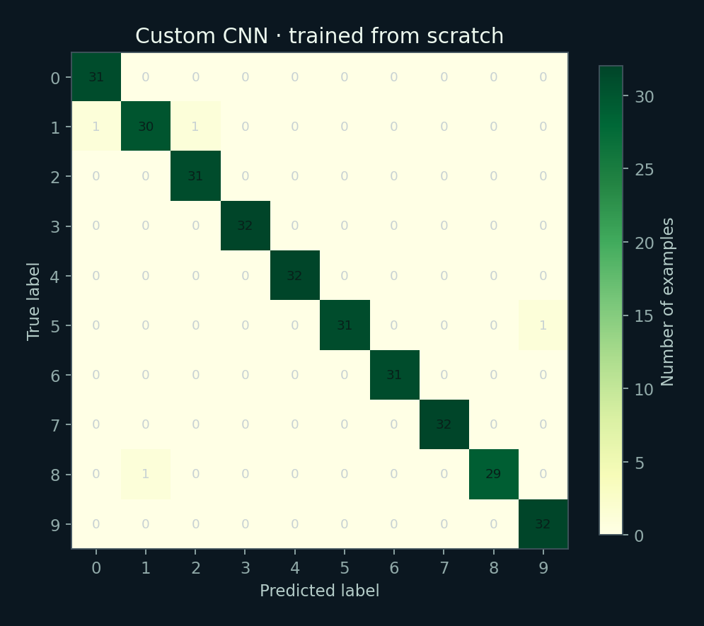
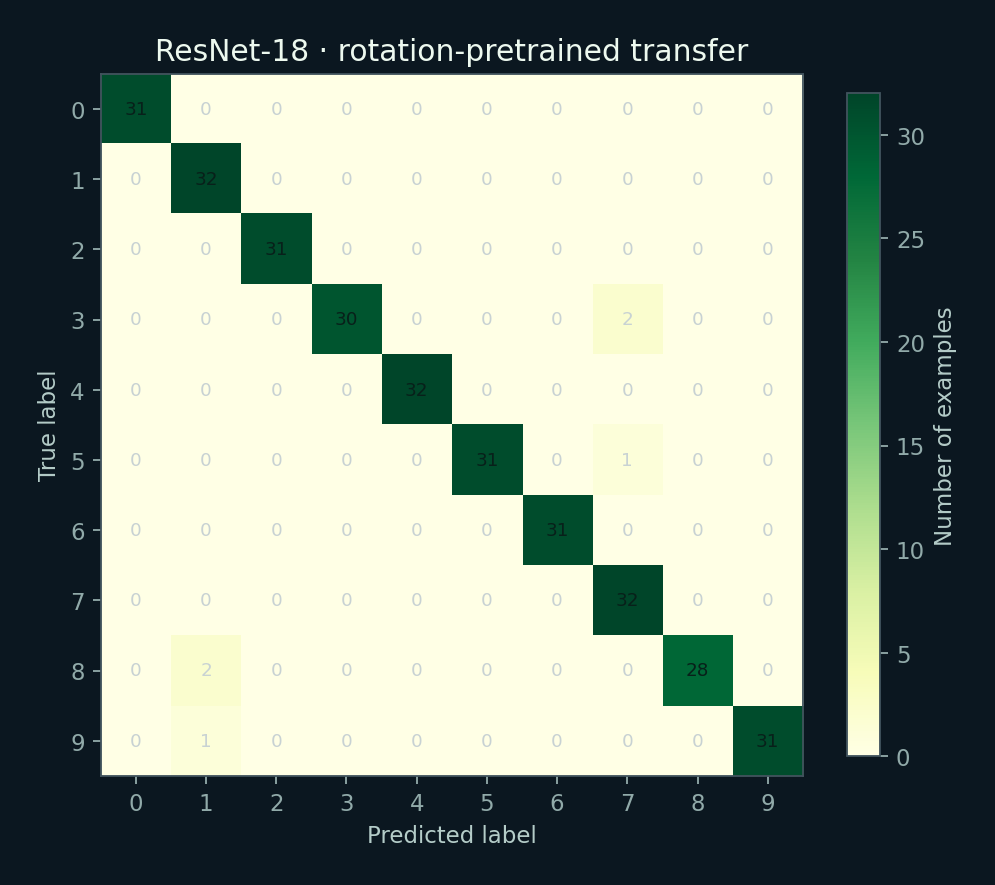
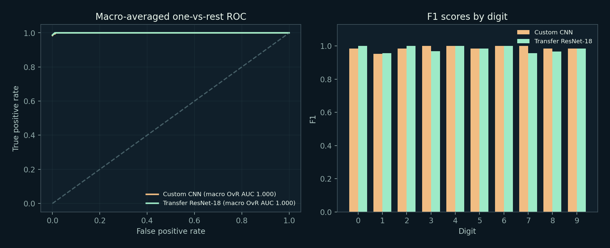
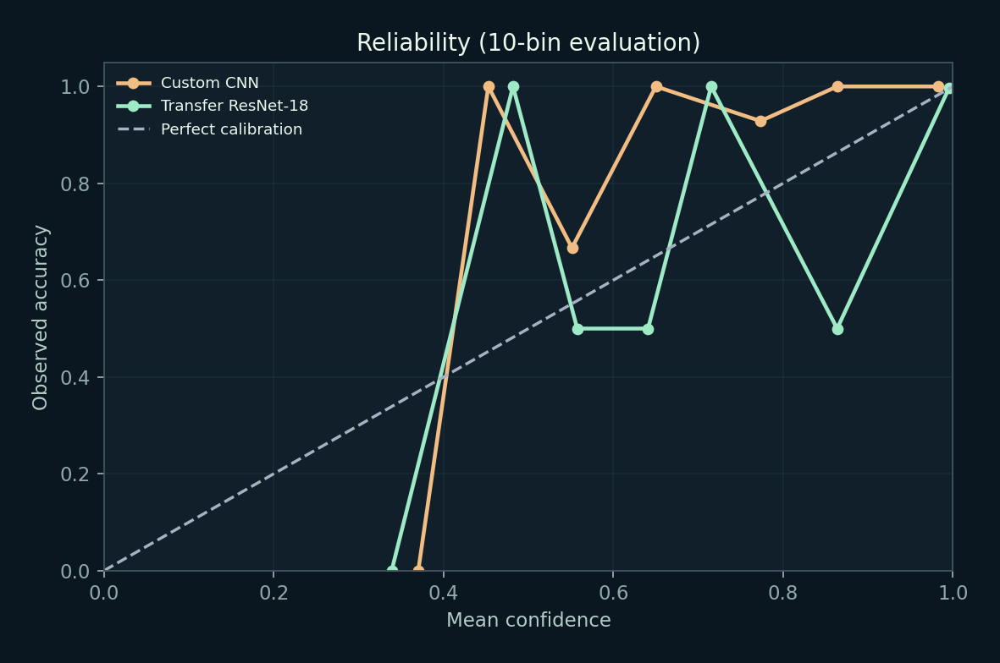
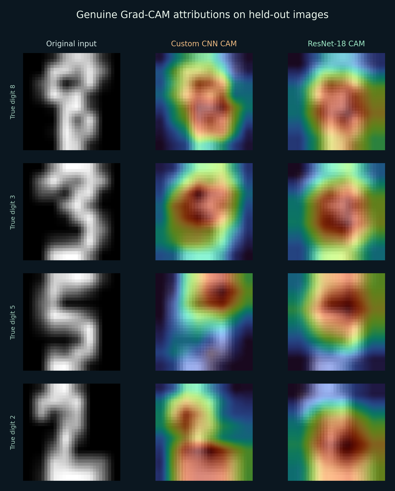

# Experiment VF-001: Offline digits pilot

**Status:** executed and verified with PyTorch on CPU, using real scikit-learn digit images. This is a *small, educational benchmark* and is not an ImageNet/CIFAR-10 result.

## Questions

1. Is a hand-built CNN competitive with a larger ResNet-18 under a fixed small-data budget?
2. Does a ResNet-18 trunk pretrained on a source task (predicting 90° rotations) transfer to supervised digit recognition?
3. Can both models produce spatial, class-specific Grad-CAM attributions?

## Data and split

- scikit-learn `load_digits`, 1,797 8×8 grayscale digit images, intensities 0–16.
- Intensities divided by 16; bilinear upsampling from 8×8 to 32×32. Upsampling does **not** add detail.
- Fixed random seed 42; stratified partitions: train 1,168, validation 314, test 315.
- Identical fixed partitions for both models. Separate validation/test data. Pretext source training draws only from the training partition.
- No external training examples, no ImageNet weights and no claimed benchmark-generalizable SOTA.

## Model A — custom CNN

- Three stages of 32/64/96 feature channels, ReLU and batch normalization, 2×2 max-pooling, adaptive average pooling, dropout, and 10-class linear head.
- Random initialization; AdamW, learning rate 0.002; 14 epochs; best validation epoch 11.

## Model B — transfer ResNet-18

- ResNet-18 with 1-channel 3×3 stem, no first max-pool (appropriate for 32px input).
- **Actual source pretraining:** predict one of four rotations (0°, 90°, 180°, 270°) on train-partition images; 2 epochs; head initially produces four logits.
- **Actual downstream transfer:** replace source head with ten-output linear head, fine-tune entire network on the same labeled training partition; AdamW learning rate 0.0007; 6 epochs; best validation epoch 6.
- This is *task-based, in-domain self-supervised transfer*; **not** ImageNet-pretrained ResNet-18. The source-task score in the raw history is evaluated on training-partition rotations, not an independent source validation set.
- One model receives an additional pretraining phase and augmented, unlabeled views. Comparison is illustrative, not compute-matched or source-budget-matched.

## Result summary

| Metric | Custom CNN | Rotation-pretrained ResNet-18 |
|---|---:|---:|
| Held-out accuracy | **98.730%** | 98.095% |
| Macro precision | 98.749% | 98.286% |
| Macro recall | 98.729% | 98.083% |
| Macro F1 | 98.724% | 98.120% |
| Multiclass ROC-AUC (OvR, macro) | 0.999887 | 0.999932 |
| Expected calibration error (10 bins) | 0.044678 | 0.009299 |
| 95% bootstrap accuracy CI¹ | [97.460%, 99.683%] | [96.508%, 99.365%] |
| Held-out test size | 315 | 315 |

¹ Percentile intervals from 400 bootstrap resamples of the *same* 315 test examples. They describe resampling uncertainty, not external validation.

Both approaches perform strongly on this simple, small dataset. **The smaller custom CNN performed slightly better in accuracy and macro F1; the transfer network showed lower calibration error and marginally higher ROC-AUC.** The accuracy difference is only two test examples and should not be presented as statistically decisive. No claim of general superiority can be made from one random split, one seed, and an unequal pretraining budget.

## Figures









## What's missing

This small pilot does not establish performance on realistic, high-resolution colour photographs. There is no full ImageNet-to-CIFAR experiment in the verified results. An optional script, `scripts/train_cifar10.py`, implements the larger experiment but it has **not** been executed in this package. The project's static dashboard displays stored, genuine test inferences; it does not support arbitrary web-browser image uploads. The Streamlit app supports uploads through real local/server inference.

## Reproduction

From the repository root, after installing dependencies:

```bash
python scripts/run_experiment.py --cnn-epochs 14 --pretext-epochs 2 --transfer-epochs 6
python scripts/export_assets.py
pytest -q tests
```

These commands regenerate experiment artifacts and figures; they are provided for reproducibility, **not required to view the included model outputs**.
